<a href="mailto:emadadin17@gmail.com"><picture><source media="(prefers-color-scheme: dark)" srcset="assets/hero-v23-dark.svg"></picture></a>

 
<a href="mailto:emadadin17@gmail.com">CONT·CT</a> &nbsp;&nbsp;·&nbsp;&nbsp; <a href="https://ai-asaas.com">·S··S</a> &nbsp;&nbsp;·&nbsp;&nbsp; <a href="https://github.com/emadadin20">GITHUB</a> &nbsp;&nbsp;·&nbsp;&nbsp; <a href="https://wa.me/967773774428">WH·TS·PP</a> &nbsp;&nbsp;·&nbsp;&nbsp; <a href="https://linkedin.com">LINKEDIN</a>

 
 
<picture><source media="(prefers-color-scheme: dark)" srcset="assets/h-prologue-dark.svg"></picture>

<picture><source media="(prefers-color-scheme: dark)" srcset="assets/prologue-dark.svg"></picture>

 
 
<picture><source media="(prefers-color-scheme: dark)" srcset="assets/h-practice-dark.svg"></picture>

<picture><source media="(prefers-color-scheme: dark)" srcset="assets/practice-v3-dark.svg"></picture>

 
 
<picture><source media="(prefers-color-scheme: dark)" srcset="assets/h-activity-dark.svg"></picture>

<picture><source media="(prefers-color-scheme: dark)" srcset="https://raw.githubusercontent.com/emadadin20/emadadin20/output/snake-dark.svg"></picture>

 
 
 
<a href="mailto:emadadin17@gmail.com"><picture><source media="(prefers-color-scheme: dark)" srcset="assets/epilogue-v2-dark.svg"></picture></a>

