<a href="https://ai-asaas.com">
  
</a>

  
  
  
  
  




  
  


  


  


<picture>
  <source media="(prefers-color-scheme: dark)" srcset="https://raw.githubusercontent.com/emadadin20/emadadin20/output/snake-dark.svg">
  
</picture>

  


  
  
  
  
  

<a href="https://ai-asaas.com">
  
</a>
