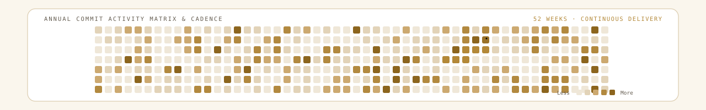

<!-- HERO BANNER (DUAL-THEME) -->
<picture>
  <source media="(prefers-color-scheme: dark)" srcset="assets/hero-dark.svg">
  
</picture>

 

  <a href="https://github.com/emadadin20?tab=repositories">REPOSITORIES</a>
  &nbsp;&nbsp;·&nbsp;&nbsp;
  <a href="#featured-works">FEATURED WORKS</a>
  &nbsp;&nbsp;·&nbsp;&nbsp;
  <a href="#engineering-disciplines">TECH STACK</a>
  &nbsp;&nbsp;·&nbsp;&nbsp;
  <a href="https://wa.me/967773774428">WHATSAPP</a>
  &nbsp;&nbsp;·&nbsp;&nbsp;
  <a href="mailto:emadadin17@gmail.com">DIRECT CONTACT</a>

 
 

<!-- SECTION I: PROLOGUE -->
<picture>
  <source media="(prefers-color-scheme: dark)" srcset="assets/h-prologue-dark.svg">
  
</picture>

<picture>
  <source media="(prefers-color-scheme: dark)" srcset="assets/prologue-dark.svg">
  
</picture>

 
 

<!-- SECTION II: PRACTICE & TECH STACK -->

<picture>
  <source media="(prefers-color-scheme: dark)" srcset="assets/h-practice-dark.svg">
  
</picture>

<picture>
  <source media="(prefers-color-scheme: dark)" srcset="assets/practice-dark.svg">
  
</picture>

 
 

<!-- SECTION III: FEATURED WORKS & PROJECTS -->

<picture>
  <source media="(prefers-color-scheme: dark)" srcset="assets/h-projects-dark.svg">
  
</picture>

<picture>
  <source media="(prefers-color-scheme: dark)" srcset="assets/projects-dark.svg">
  
</picture>

 
 

<!-- SECTION IV: ACTIVITY & CADENCE -->
<picture>
  <source media="(prefers-color-scheme: dark)" srcset="assets/h-activity-dark.svg">
  
</picture>

<!-- DYNAMIC CONTRIBUTION MATRIX (SNAKE GRAPH) -->
<picture>
  <source media="(prefers-color-scheme: dark)" srcset="assets/snake-dark.svg">
  
</picture>

 
 
 

<!-- EPILOGUE CALL TO ACTION -->
<a href="mailto:emadadin17@gmail.com">
  <picture>
    <source media="(prefers-color-scheme: dark)" srcset="assets/epilogue-dark.svg">
    
  </picture>
</a>

