<!-- HERO BANNER — THE BURGUNDY SYSTEM -->
<a href="mailto:emadadin17@gmail.com"><picture>
  <source media="(prefers-color-scheme: dark)" srcset="assets/hero-burgundy-dark.svg">
  
</picture></a>

 

<!-- NAVIGATION BAR -->

  <a href="mailto:emadadin17@gmail.com">CONTACT</a>
  &nbsp;&nbsp;&middot;&nbsp;&nbsp;
  <a href="https://ai-asaas.com">ASAAS</a>
  &nbsp;&nbsp;&middot;&nbsp;&nbsp;
  <a href="https://github.com/emadadin20">GITHUB</a>
  &nbsp;&nbsp;&middot;&nbsp;&nbsp;
  <a href="https://wa.me/967773774428">WHATSAPP</a>
  &nbsp;&nbsp;&middot;&nbsp;&nbsp;
  <a href="https://linkedin.com">LINKEDIN</a>

 
 

<!-- SECTION I: PROLOGUE -->
<picture>
  <source media="(prefers-color-scheme: dark)" srcset="assets/h-prologue-burgundy-dark.svg">
  
</picture>

<picture>
  <source media="(prefers-color-scheme: dark)" srcset="assets/prologue-burgundy-dark.svg">
  
</picture>

 
 

<!-- SECTION II: PRACTICE & DISCIPLINES -->
<picture>
  <source media="(prefers-color-scheme: dark)" srcset="assets/h-practice-burgundy-dark.svg">
  
</picture>

<picture>
  <source media="(prefers-color-scheme: dark)" srcset="assets/practice-burgundy-dark.svg">
  
</picture>

 
 

<!-- SECTION III: ACTIVITY & CODE FREQUENCY -->
<picture>
  <source media="(prefers-color-scheme: dark)" srcset="assets/h-activity-burgundy-dark.svg">
  
</picture>

<picture>
  <source media="(prefers-color-scheme: dark)" srcset="https://raw.githubusercontent.com/emadadin20/emadadin20/output/snake-dark.svg">
  
</picture>

 
 

<!-- SECTION IV: EPILOGUE (CALL TO ACTION FOOTER) -->
<a href="mailto:emadadin17@gmail.com"><picture>
  <source media="(prefers-color-scheme: dark)" srcset="assets/epilogue-burgundy-dark.svg">
  
</picture></a>

